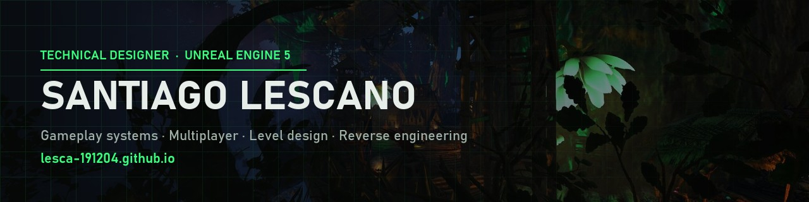

<h3 align="center">🎮 Interested in my work? Check out my portfolio</h3>

  

  
  
  
  

---

### 👋 Hi, I'm Santiago

**Technical Designer & gameplay programmer working in Unreal Engine.** I design and build gameplay systems — from mechanics and networked UI to engine-level work.

- 🏗️ Founder of a small indie studio, building a **multiplayer survival game in UE5** (ocean & ship physics, networking, creature AI, dynamic weather)
- 🧩 5 years shipping **ARK: Survival Evolved / Ascended** content: a premium mod, a total-conversion server and full maps
- 🔧 Lead of the **Killzone Shadow Fall PC Port**, an open-source native port of a PS4 exclusive
- 🌎 Argentina · open to **full-time remote** roles · English / Español

### ⭐ Featured work

| | Project | |
|---|---|---|
| 🔫 | **[Killzone Shadow Fall PC Port](https://github.com/lesca-191204/killzone-shadowfall-pc)** — native Windows port: reverse engineering, C/C++, Vulkan, DLSS/FSR, multiplayer | **333★ · 24K+ downloads** |
| 🛡️ | **[Turret Utilities](https://lesca-191204.github.io/projects/turret-utilities.html)** — premium ARK: Survival Ascended mod (Studio Wildcard × CurseForge) | **34K+ downloads** |
| 🌌 | **[Arkadox Z](https://lesca-191204.github.io/projects/arkadox-z.html)** — roleplay server: original map, real-time cinematic events, missions for 50+ players | **70 concurrent players** |
| 🏞️ | **[Nova](https://lesca-191204.github.io/projects/nova.html)** — full-size UE5 open-world map (World Partition, Nanite, Lumen) | **Level design** |

### 🛠️ Tools & tech

**Engine & code** 

**Content** 

**Workflow** 

---

🇦🇷 ¿Hablás español? Mi portfolio también está en español: <a href="https://lesca-191204.github.io">lesca-191204.github.io</a> (botón EN/ES arriba a la derecha).

